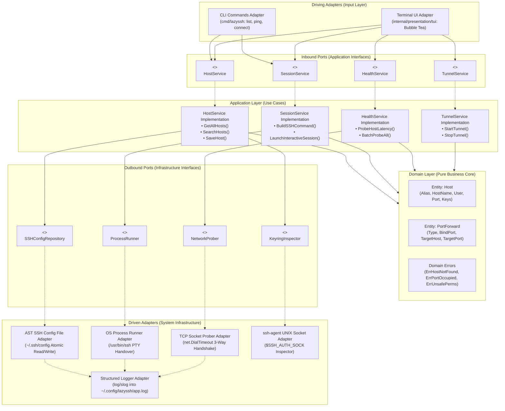
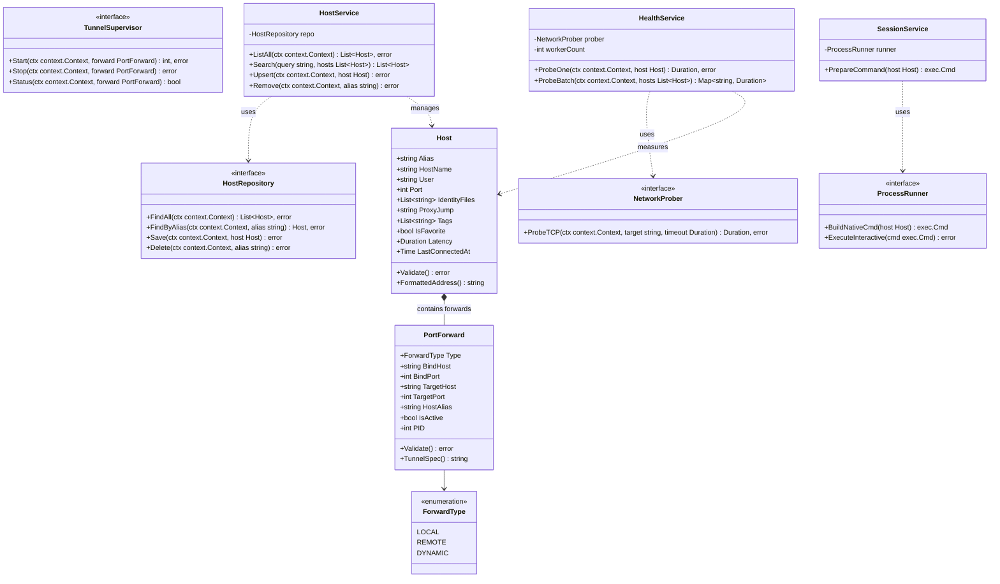
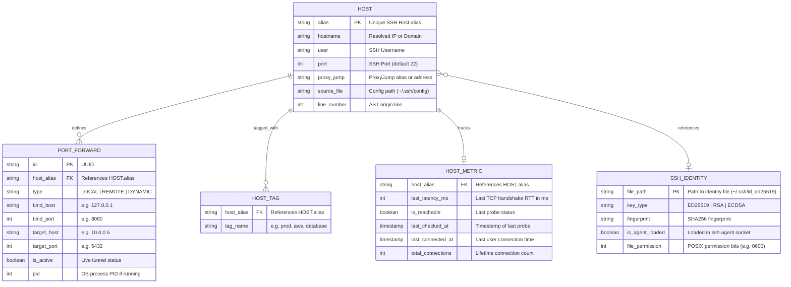
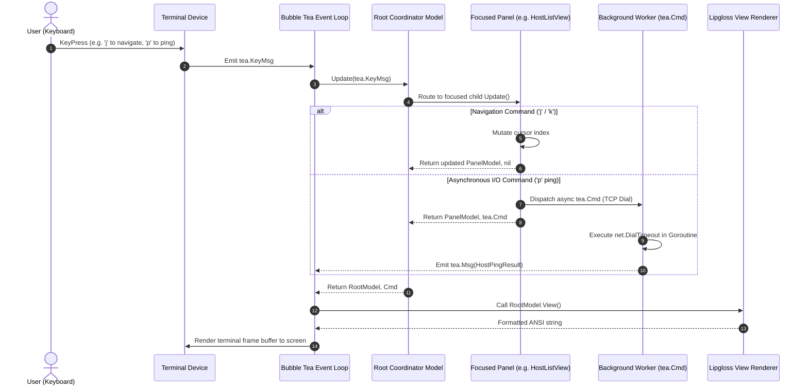
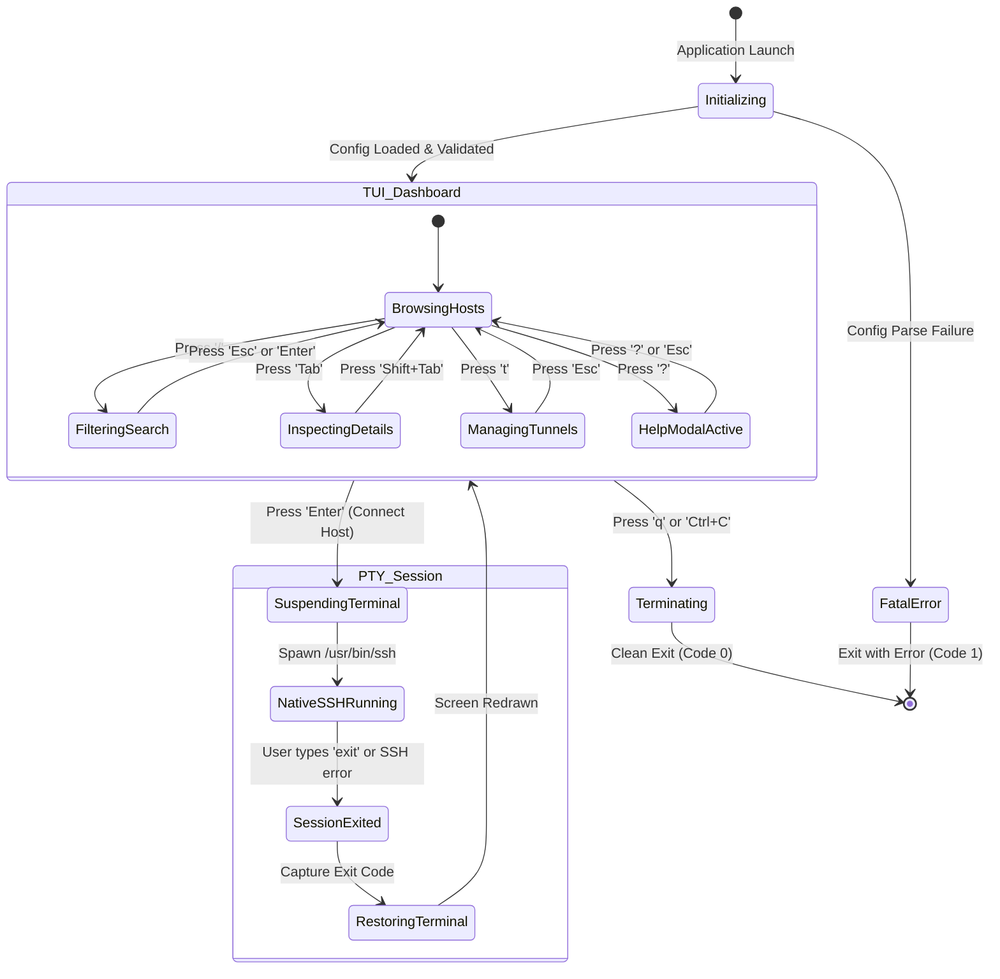
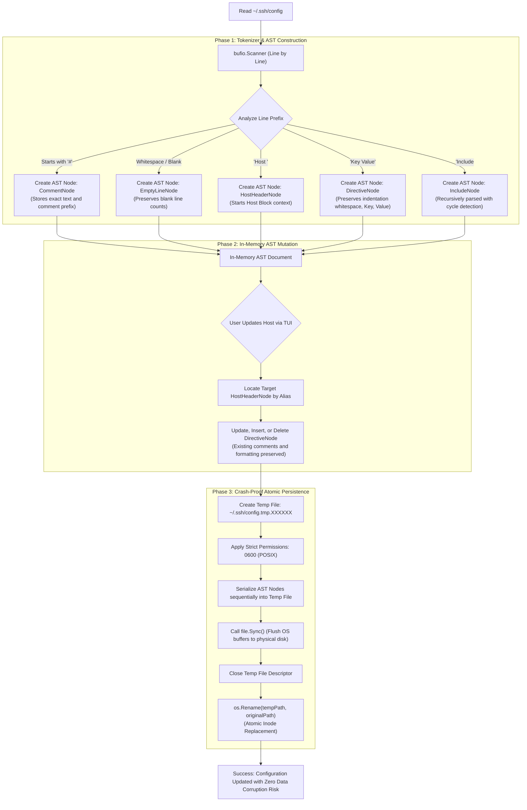
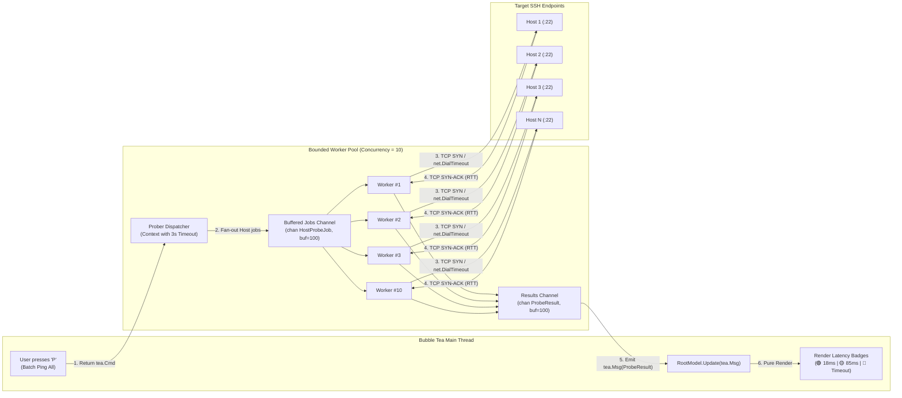
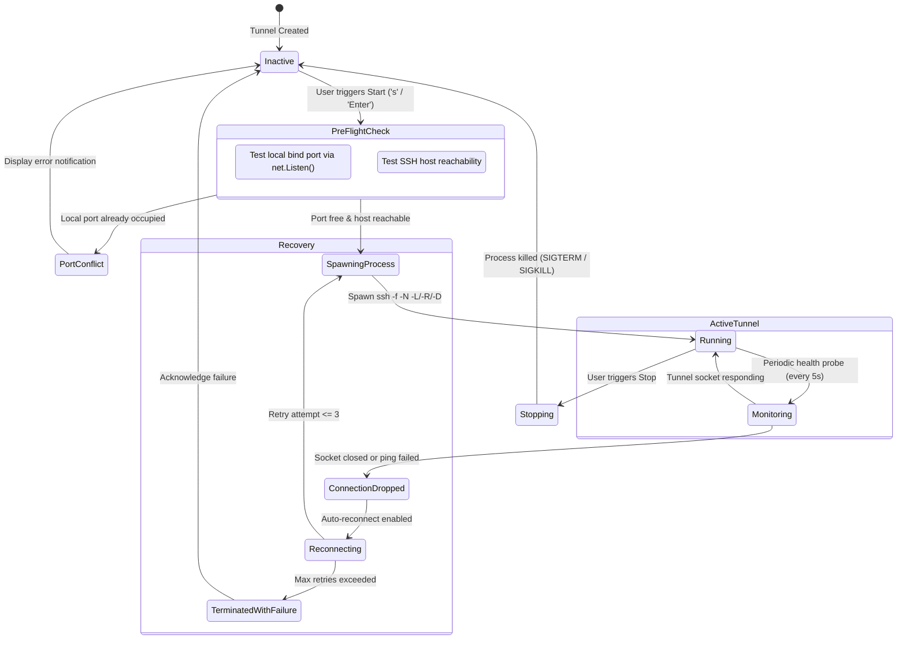

# Architecture Guide

This document defines the software architecture, design patterns, internal component boundaries, and complete UML specifications for **lazyssh**.

---

## Table of Contents

1. [Architectural Philosophy: Hexagonal Architecture](#1-architectural-philosophy-hexagonal-architecture)
2. [Domain Class Diagram (UML Class Diagram)](#2-domain-class-diagram-uml-class-diagram)
3. [Domain Entity Relationships (UML ER Diagram)](#3-domain-entity-relationships-uml-er-diagram)
4. [Terminal UI & The Elm Architecture](#4-terminal-ui--the-elm-architecture)
5. [Native SSH PTY Handover Lifecycle](#5-native-ssh-pty-handover-lifecycle)
6. [Terminal State Machine (UML State Diagram)](#6-terminal-state-machine-uml-state-diagram)
7. [Non-Destructive AST SSH Config Engine](#7-non-destructive-ast-ssh-config-engine)
8. [Bounded Concurrency & Health Prober Model](#8-bounded-concurrency--health-prober-model)
9. [Tunnel Supervisor Lifecycle (UML State Diagram)](#9-tunnel-supervisor-lifecycle-uml-state-diagram)
10. [Security Posture & Boundary Principles](#10-security-posture--boundary-principles)

---

## 1. Architectural Philosophy: Hexagonal Architecture

`lazyssh` implements **Hexagonal Architecture (Ports and Adapters)**. The business domain (Host Management, SSH Tunnels, Health Monitoring) is strictly isolated from presentation adapters (Bubble Tea TUI, Cobra CLI) and infrastructure adapters (File System, OS Process Execution, TCP Sockets).



---

## 2. Domain Class Diagram (UML Class Diagram)

This class diagram depicts the object-oriented structure, interfaces, dependencies, and composition across the domain and application layers:



---

## 3. Domain Entity Relationships (UML ER Diagram)

The conceptual data model representing OpenSSH hosts, tunnel definitions, local metadata, and SSH identities:



---

## 4. Terminal UI & The Elm Architecture

`lazyssh` employs the **Elm Architecture** (Model-Update-View) via Bubble Tea. This sequence diagram illustrates the unidirectional event loop and message passing:



---

## 5. Native SSH PTY Handover Lifecycle

The native terminal handover mechanism suspends the Bubble Tea event loop, executes the system `/usr/bin/ssh` binary with direct PTY ownership, and restores the TUI upon session completion:

```mermaid
sequenceDiagram
    autonumber
    actor User as User (Terminal)
    participant TUI as Bubble Tea Engine
    participant SessionSVC as SessionService
    participant KernelPTY as Linux PTY / Kernel TTY
    participant SSHProc as /usr/bin/ssh Client Process
    participant RemoteServer as Remote SSH Host (:22)

    User->>TUI: Presses 'Enter' on selected host (prod-db)
    TUI->>SessionSVC: BuildCommand(host)
    SessionSVC-->>TUI: Return *exec.Cmd ("/usr/bin/ssh", "prod-db")

    rect rgb(25, 35, 55)
        note over TUI, KernelPTY: Phase 1: Terminal Suspension
        TUI->>KernelPTY: Release Terminal Raw Mode (tcsetattr ICANON/ECHO)
        TUI->>KernelPTY: Restore default Stdin / Stdout / Stderr streams
        TUI->>KernelPTY: Make hardware cursor visible (\033[?25h)
    end

    rect rgb(20, 45, 30)
        note over KernelPTY, RemoteServer: Phase 2: Native SSH PTY Execution
        TUI->>SSHProc: Spawn process via tea.ExecProcess(cmd)
        SSHProc->>KernelPTY: Allocate Master/Slave PTY pair
        SSHProc->>RemoteServer: TCP Connect & SSH Handshake
        SSHProc->>RemoteServer: Authenticate (ssh-agent, YubiKey, Keys)
        RemoteServer-->>SSHProc: Interactive Remote Shell Session Granted
        User<-->>SSHProc: Full Interactive Shell (tmux, vim, htop, SIGWINCH resize)
    end

    rect rgb(45, 25, 25)
        note over User, SSHProc: Phase 3: Session Termination
        User->>SSHProc: Disconnects or types 'exit'
        SSHProc->>KernelPTY: Flush PTY buffers and close descriptors
        SSHProc-->>TUI: Process exits with exit code (0)
    end

    rect rgb(25, 35, 55)
        note over TUI, KernelPTY: Phase 4: Terminal Restoration
        TUI->>KernelPTY: Re-acquire Terminal Raw Mode
        TUI->>KernelPTY: Switch to Alternate Screen Buffer (\033[?1049h)
        TUI->>KernelPTY: Hide hardware cursor (\033[?25l)
        TUI->>User: Redraw lazyssh Dashboard immediately
    end
```

---

## 6. Terminal State Machine (UML State Diagram)

The operational states of the terminal interface during user interactions and process handover:



---

## 7. Non-Destructive AST SSH Config Engine

How `lazyssh` reads, modifies, and safely writes `~/.ssh/config` while preserving all comments, indentation, and formatting:



---

## 8. Bounded Concurrency & Health Prober Model

The architecture of the asynchronous TCP latency prober, preventing file descriptor exhaustion through bounded worker pooling:



---

## 9. Tunnel Supervisor Lifecycle (UML State Diagram)

The state machine governing background SSH port forwarding tunnels (`-L`, `-R`, `-D`):



---

## 10. Security Posture & Boundary Principles

1. **Zero Secret Persistence**:
   - `lazyssh` never reads, buffers, or stores private key material or SSH passphrases in application memory or disk. All cryptography is delegated to OpenSSH and `ssh-agent`.
2. **POSIX Permissions Enforcement**:
   - `~/.ssh/config` modifications are written with file mode `0600` (`-rw-------`). Directories are validated for `0700` (`drwx------`).
3. **Atomic Replacement Invariant**:
   - Direct file overwrites are forbidden. All file updates follow the strict: `TempFile -> Write -> fsync() -> Close -> os.Rename()` atomic transaction chain.
4. **Command Injection Prevention**:
   - External command execution forbids raw shell strings (`sh -c`). Commands are constructed as explicit parameter slices passed directly to system exec syscalls (`syscall.Execve` / `os/exec.Command`).
5. **Cycle Detection for Include Directives**:
   - The AST resolver maintains an in-memory hash set of visited canonical paths (`filepath.EvalSymlinks`) to detect and reject recursive file inclusions or malicious symlink loops.
